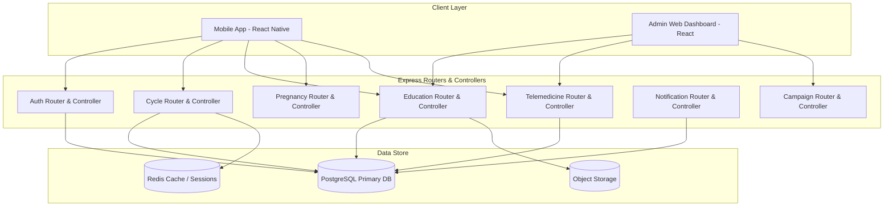

# Software Design Document (SDD)
## Red Apple — Fertility & Women's Health Platform

---

## 1. System Architecture Overview

### 1.1 Architectural Pattern
Red Apple backend is built using standard **Express.js** architecture (`routes/`, `controllers/`, `middleware/`). This architecture ensures rapid deployment cycles while preserving clean separation of concerns.

### 1.2 Component Diagram



### 1.3 Technology Stack

| Layer | Component | Specification |
|---|---|---|
| **Mobile App** | iOS & Android | React Native (Expo SDK 54, TypeScript) |
| **Admin Dashboard** | Web App | React |
| **Backend API** | Express.js Standard | Node.js, Express, TypeScript (`routes/`, `controllers/`) |
| **Database** | Primary Relational DB | PostgreSQL |
| **Cache & Session** | In-Memory Cache | Redis |
| **Object Storage** | Asset Storage | S3 / Cloud Storage |
| **Push Notifications** | Mobile Push | Firebase Cloud Messaging (FCM) |

---

## 2. Module Specifications

### 2.1 Auth & Privacy Module
- **Responsibilities**: Account registration, session management, JWT issuance, local zero-knowledge encryption handlers, role-based access control (RBAC).

### 2.2 Cycle & Fertility Analytics Module
- **Responsibilities**: Cycle log CRUD, rolling-average ovulation calculations, fertile window prediction, offline log synchronization reconciliation.

### 2.3 Education Content Module
- **Responsibilities**: Article creation, versioning, category tagging, medical review workflow publishing.

### 2.4 Pregnancy Tracking Module
- **Responsibilities**: Gestational age calculations, milestone progress alerts, antenatal visit scheduling.

### 2.5 Telemedicine Module
- **Responsibilities**: Specialist directory, real-time availability slot management, consultation booking lifecycle, virtual video room generation.

### 2.6 Notification Module
- **Responsibilities**: Job scheduling for fertile window alerts, period start warnings, and appointment reminders.

### 2.7 Campaign Module
- **Responsibilities**: Health awareness campaigns and educational partner initiative management.

---

## 3. Database Schema (PostgreSQL DDL)

```sql
CREATE TABLE users (
    user_id UUID PRIMARY KEY DEFAULT gen_random_uuid(),
    name VARCHAR(120) NOT NULL,
    email VARCHAR(160) UNIQUE,
    phone VARCHAR(20) UNIQUE,
    password_hash TEXT NOT NULL,
    date_of_birth DATE,
    pregnancy_mode BOOLEAN NOT NULL DEFAULT FALSE,
    role VARCHAR(20) NOT NULL DEFAULT 'user',
    created_at TIMESTAMPTZ NOT NULL DEFAULT now(),
    updated_at TIMESTAMPTZ NOT NULL DEFAULT now()
);

CREATE TABLE cycle_logs (
    log_id UUID PRIMARY KEY DEFAULT gen_random_uuid(),
    user_id UUID NOT NULL REFERENCES users(user_id) ON DELETE CASCADE,
    start_date DATE NOT NULL,
    end_date DATE,
    flow_intensity VARCHAR(20),
    symptoms JSONB DEFAULT '[]',
    client_uuid UUID,
    created_at TIMESTAMPTZ NOT NULL DEFAULT now()
);

CREATE TABLE pregnancy_trackers (
    tracker_id UUID PRIMARY KEY DEFAULT gen_random_uuid(),
    user_id UUID NOT NULL UNIQUE REFERENCES users(user_id) ON DELETE CASCADE,
    conception_date DATE,
    lmp_date DATE,
    current_week INT,
    due_date DATE,
    created_at TIMESTAMPTZ NOT NULL DEFAULT now()
);

CREATE TABLE education_articles (
    article_id UUID PRIMARY KEY DEFAULT gen_random_uuid(),
    title VARCHAR(200) NOT NULL,
    category_id UUID REFERENCES categories(category_id),
    content TEXT NOT NULL,
    status VARCHAR(20) NOT NULL DEFAULT 'draft',
    reviewed_by UUID REFERENCES users(user_id),
    last_updated TIMESTAMPTZ NOT NULL DEFAULT now()
);

CREATE TABLE categories (
    category_id UUID PRIMARY KEY DEFAULT gen_random_uuid(),
    name VARCHAR(100) NOT NULL UNIQUE
);

CREATE TABLE clinics (
    clinic_id UUID PRIMARY KEY DEFAULT gen_random_uuid(),
    name VARCHAR(160) NOT NULL,
    location VARCHAR(200),
    contact_email VARCHAR(160),
    contact_phone VARCHAR(20),
    created_at TIMESTAMPTZ NOT NULL DEFAULT now()
);

CREATE TABLE doctors (
    doctor_id UUID PRIMARY KEY DEFAULT gen_random_uuid(),
    clinic_id UUID NOT NULL REFERENCES clinics(clinic_id) ON DELETE CASCADE,
    name VARCHAR(120) NOT NULL,
    specialty VARCHAR(100)
);

CREATE TABLE availability_slots (
    slot_id UUID PRIMARY KEY DEFAULT gen_random_uuid(),
    doctor_id UUID NOT NULL REFERENCES doctors(doctor_id) ON DELETE CASCADE,
    start_time TIMESTAMPTZ NOT NULL,
    end_time TIMESTAMPTZ NOT NULL,
    is_booked BOOLEAN NOT NULL DEFAULT FALSE
);

CREATE TABLE bookings (
    booking_id UUID PRIMARY KEY DEFAULT gen_random_uuid(),
    user_id UUID NOT NULL REFERENCES users(user_id),
    clinic_id UUID NOT NULL REFERENCES clinics(clinic_id),
    doctor_id UUID NOT NULL REFERENCES doctors(doctor_id),
    slot_id UUID REFERENCES availability_slots(slot_id),
    scheduled_time TIMESTAMPTZ NOT NULL,
    status VARCHAR(20) NOT NULL DEFAULT 'requested',
    created_at TIMESTAMPTZ NOT NULL DEFAULT now()
);

CREATE TABLE reminders (
    reminder_id UUID PRIMARY KEY DEFAULT gen_random_uuid(),
    user_id UUID NOT NULL REFERENCES users(user_id) ON DELETE CASCADE,
    type VARCHAR(40) NOT NULL,
    trigger_time TIMESTAMPTZ NOT NULL,
    sent BOOLEAN NOT NULL DEFAULT FALSE
);

-- Essential Performance Indexes
CREATE INDEX idx_cycle_logs_user_id ON cycle_logs(user_id);
CREATE INDEX idx_bookings_user_id ON bookings(user_id);
CREATE INDEX idx_bookings_status ON bookings(status);
CREATE INDEX idx_availability_doctor_time ON availability_slots(doctor_id, start_time);
```

---

## 4. Security & Error Handling

- **Encryption**: AES-256 for health data at rest; TLS 1.3 for data in transit.
- **Access Control**: Role-Based Access Control (RBAC) enforced at the API gateway level.
- **Log Hygiene**: Sensitive fields (passwords, tokens, raw cycle logs) are automatically redacted from server logs.
