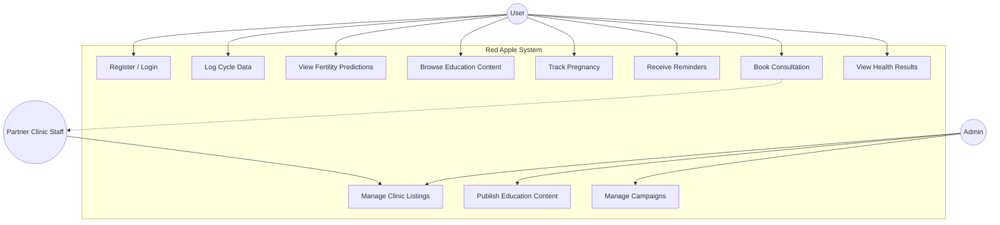
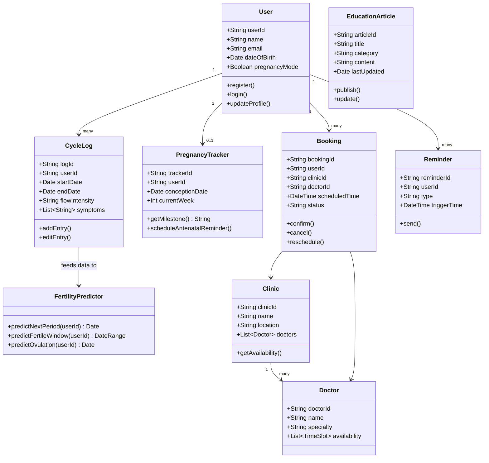
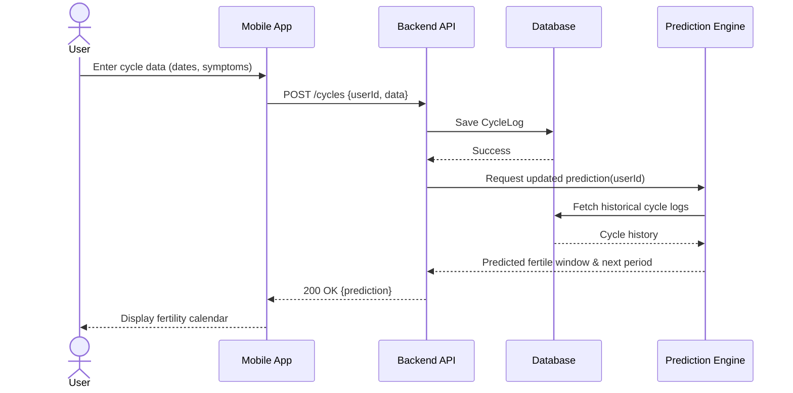
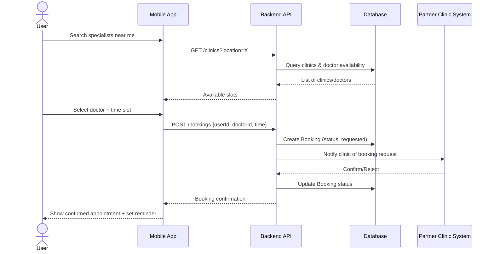
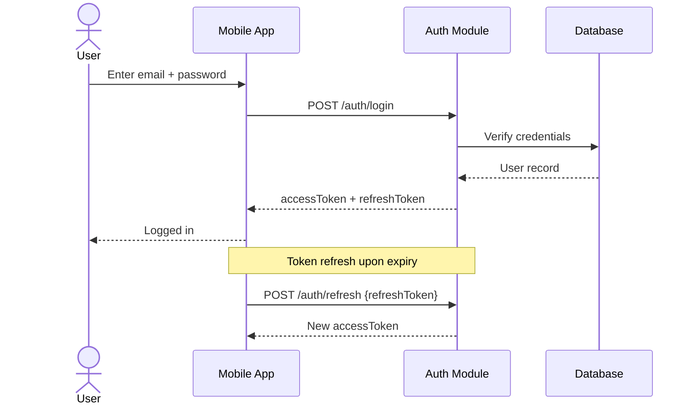
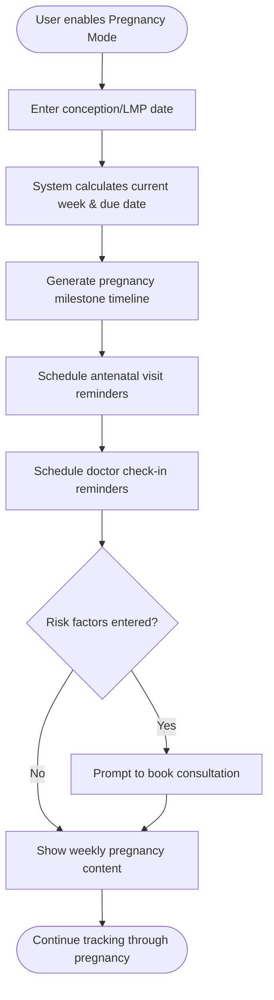
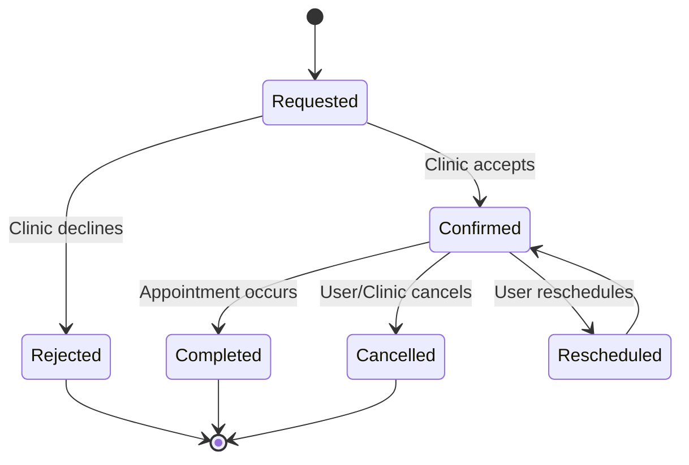
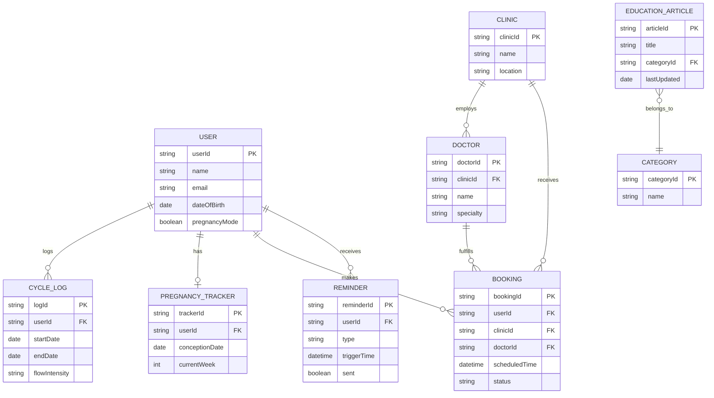

# UML Diagrams & Behavior Specifications
## Red Apple — Fertility & Women's Health Platform

---

## 1. Use Case Diagram

---

## 2. Class Diagram

---

## 3. Sequence Diagrams

### 3.1 Cycle Logging & Fertility Prediction

### 3.2 Telemedicine Consultation Booking

### 3.3 Session Authentication

---

## 4. Behavior & State Diagrams

### 4.1 Activity Diagram — Pregnancy Mode Onboarding

### 4.2 State Diagram — Booking Lifecycle

---

## 5. Entity-Relationship Diagram

