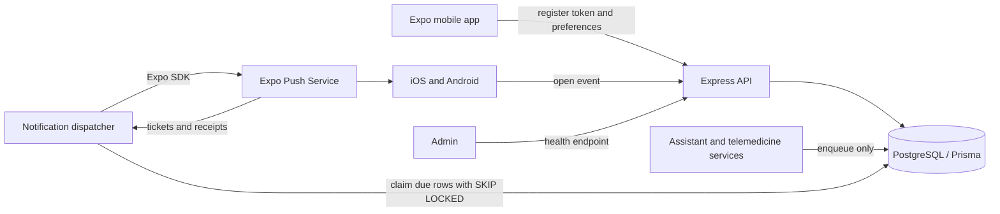

# Notification Architecture

## Components

The API and dispatcher are hosted in the backend process. `NOTIFICATIONS_ENABLED` is the global kill switch; `NOTIFICATION_WORKER_ENABLED` independently controls the worker. The worker is safe to run in multiple backend replicas because it claims rows using PostgreSQL row locks with `SKIP LOCKED`.

## Storage

- `DeviceToken` stores one Expo token per device, owner, platform, and disable state. A token reassigned to a new authenticated user is removed from the prior owner.
- `NotificationPreference` stores the master switch, categories, IANA timezone, quiet hours, tone, and per-user daily limit.
- `Notification` is the durable outbox and in-app history. Unique `dedupe_key` prevents duplicate planning. Status moves through pending, processing, sent, suppressed, failed, or cancelled.
- `NotificationDelivery` records per-device Expo ticket and receipt state. DeviceNotRegistered disables that token.
- `Reminder` remains the source record for one-time and recurring reminders. The worker materializes due occurrences into the outbox.
- `TriageEvent` and `CheckInActivity` store only the signals needed for suppression and engagement timing; check-in message text is not recorded.

For both the displayed health check-in streak and engagement timing, the canonical source is `CheckInActivity`. A qualifying check-in is a saved cycle or symptom log, an explicit daily or symptom check-in, or a Dr. Red chat message. Opening the app alone does not count. Both surfaces count consecutive local calendar days in the user's saved timezone, ending today or yesterday.

## Delivery and scheduling

1. Authenticated APIs or backend services validate the request and enqueue a safe payload. The Expo token and notification body are never accepted from a client to trigger arbitrary pushes.
2. Engagement messages are derived from deterministic activity rules, respect local quiet hours, dedupe windows, and per-day safety caps. Notification titles and bodies retain their full supplied wording across categories.
3. The worker claims due outbox rows, resolves active tokens, sends Expo SDK chunks, and persists tickets. Retries use bounded exponential backoff. Receipt polling handles delayed provider errors and invalid tokens.
4. The app reports opens to an ownership-checked endpoint and routes only to the allowlisted assistant or appointments screens. Entry seeds are allowlisted and are consumed locally as opening copy; they are not sent as clinical conclusions to the model.
5. Appointment bookings enqueue 24-hour and 1-hour reminders. Cancellation cancels pending appointment notifications.

## Operations and limits

The worker runs in-process and therefore requires at least one backend replica with worker enabled. Postgres locks coordinate multiple replicas. `/api/admin/notifications/health` reports worker heartbeat and pending queue age to authenticated admins. Structured logs include row IDs and error codes, not push tokens or message bodies. Retention cleanup removes notification and delivery records after the configured retention period and disabled tokens after the same period.

This release does not require Redis or a separate queue service. It does require a PostgreSQL deployment with the additive Prisma migration applied and Expo push credentials configured for production.
